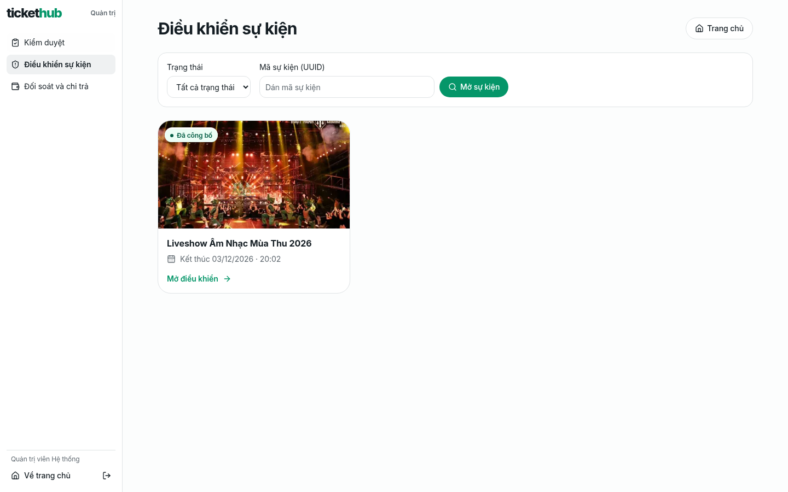
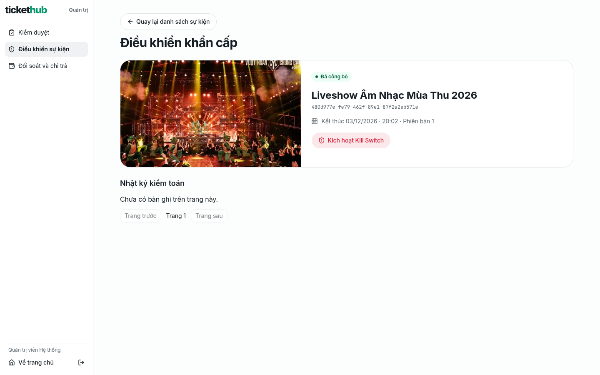

## 1. Loại thay đổi (PR Type)

Đánh dấu vào loại thay đổi tương ứng:

- [x] `feat`: Tính năng mới
- [ ] `fix`: Sửa lỗi hệ thống
- [ ] `docs`: Cập nhật tài liệu
- [ ] `refactor`: Tái cấu trúc mã nguồn (không thay đổi hành vi)
- [ ] `chore`: Cấu hình công cụ, nâng cấp thư viện, tác vụ bảo trì

## 2. Kiểm tra kỹ thuật trước khi gửi (Pre-flight Checks)

Bắt buộc thực thi và tích chọn toàn bộ các bước sau tại môi trường cục bộ:

- [x] Đã chạy `pnpm typecheck` và không có lỗi TypeScript
- [x] Đã chạy `pnpm lint` và không có lỗi vi phạm quy tắc lint
- [x] Đã chạy `pnpm format:check` và mã nguồn đã được định dạng nhất quán
- [x] Đã chạy `pnpm test` và tất cả các bài kiểm thử đều vượt qua (PASS)

## 3. Cam kết chất lượng mã nguồn (Code Quality Guarantees)

Bắt buộc xác nhận toàn bộ các cam kết dưới đây:

- [x] Không chứa mã giả lập ở client (không dùng localStorage hoặc mock để thay thế API backend)
- [x] Không sử dụng kiểu `any` (dùng schema Zod hoặc kiểu `unknown` có kiểm tra kiểu)
- [x] Tuân thủ token màu tại `docs/DESIGN_TOKENS.md` (không dùng mã hex thô không khai báo)
- [x] Không chứa biểu tượng cảm xúc (emoji) trong commit message và nội dung trao đổi
- [x] Không chứa ký tự gạch ngang dài (em-dash) trong commit message và nội dung
- [x] Không can thiệp trái phép vào hạ tầng kiểm soát (không sửa đổi .github/workflows/, scripts/pr-gate-_, scripts/audit-doc-_, tests/pr-gate-*)

## 4. Danh sách ca kiểm thử (Test Cases)

Miêu tả các ca kiểm thử đã thực hiện để chứng minh tính đúng đắn của thay đổi:

- Chromium desktop và mô phỏng Pixel 7: duyệt sự kiện, tải ảnh, xác nhận Kill Switch bằng UUID, xem nhật ký và khôi phục qua API thật.
- Đối soát theo UUID sự kiện; tạo lệnh, tạm giữ, tính lại và phê duyệt chi trả qua API thật. Hai cấu hình Chromium đều đạt.
- Kiểm tra thủ công ảnh sự kiện mẫu, nút quay lại danh sách và liên kết về trang chủ.

## 5. Ghi chú bổ sung (Additional Notes)

- UC10 dùng API quản trị thật, gồm trạng thái, phiên bản và nhật ký sự kiện. Hai bước xác nhận trên UI gồm lý do và UUID. Xác thực lại bằng OTP hoặc mật khẩu cần hợp đồng API từ BE1.
- UC11 hiển thị số liệu đối soát và số tiền chi trả do backend tính. Phê duyệt ghi nhận trạng thái `PAID_OUT` trong hệ thống.
- Lighthouse mobile trên build W06 đã ghi nhận 78, 89, 87 điểm. Trung vị 87 và lần tải lạnh 78. Firefox/WebKit bị chặn tải trong cloud; Safari, Edge và trình duyệt trong Zalo/Facebook còn chờ kiểm thử.

## 6. Minh chứng trực quan (Visual Evidence)

Bắt buộc đính kèm ít nhất 1 hình ảnh hoặc video minh chứng nếu PR có thay đổi giao diện người dùng (UI/UX) tại `apps/web`:

